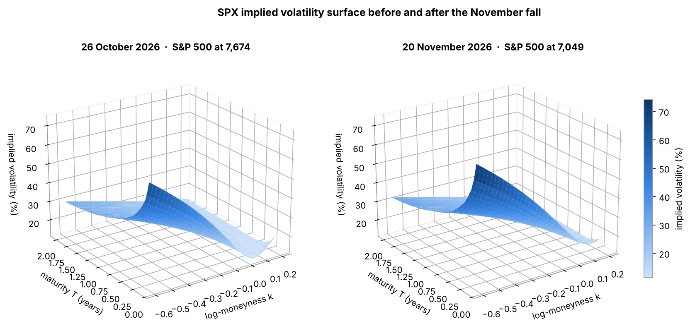
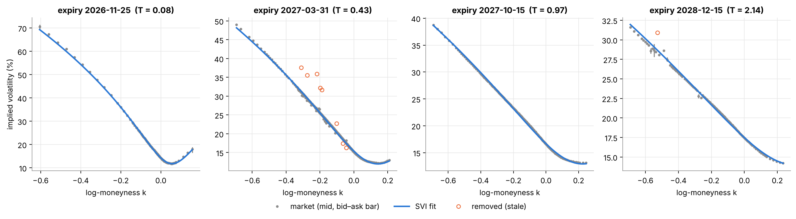
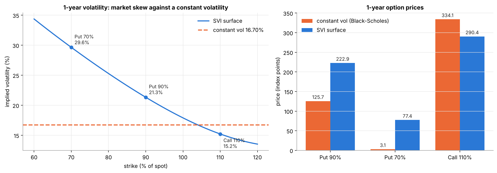
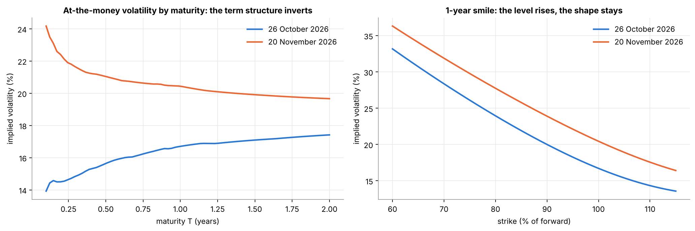

# SPX Implied Volatility Surface: from option quotes to hedge pricing

This project builds an arbitrage-free implied volatility surface for S&P 500 index options (SPX)
from free market quotes, and then uses it to price equity hedges from the point of view of an
asset manager. The surface is calibrated with the raw SVI model, checked against the static
arbitrage conditions of Gatheral and Jacquier (2014), validated against bid and ask quotes, and
verified with QuantLib. The same pipeline, run on a second date, shows how the surface changed
after a fall of the market of about 8%.



## Why a volatility surface

Listed options give prices only for some strikes and expiries, and a part of the quotes are stale
or noisy. A hedge, however, may need a strike or a maturity that is not quoted, or a scenario in
which the market moves. A smooth surface without arbitrage gives a consistent price for any
strike and maturity, and it can be used to check the prices that a bank proposes for a hedge.

A single constant volatility is not enough, because SPX options show a strong skew: protection
against large falls is priced with a much higher volatility than at-the-money options.

## Pipeline

| Notebook | What it does |
|---|---|
| `01_download.ipynb` | Downloads one snapshot of all SPX and SPXW option quotes with `yfinance` |
| `02_clean_forward.ipynb` | Filters valid quotes, chooses one option family per expiry, computes the time to expiry, builds discount rates from the Treasury curve and implies the forward price of each expiry from put-call parity |
| `03_implied_vol.ipynb` | Computes Black-76 implied volatilities (mid, bid and ask) with Brent's method |
| `04_svi.ipynb` | Calibrates a raw SVI smile to each expiry with spread-weighted least squares, adds a penalty against butterfly arbitrage and checks calendar arbitrage |
| `05_pricer.ipynb` | Turns the SVI parameters into a pricer for any strike and maturity, and validates it against the market |
| `06_quantlib.ipynb` | Verifies the pricer with QuantLib and compares a constant volatility with the SVI surface |
| `07_surface_change.ipynb` | Compares the surfaces of 26 October and 20 November 2026: volatility level, term structure, skew and cost of protection |

Shared functions (Black price, implied volatility, SVI and the butterfly function g) are in
`functions.py`.

## Main results

All results refer to the snapshot of 26 October 2026, 10:30 New York time.

**Data.** From 19,594 quotes, the cleaning step keeps 8,997 out-of-the-money options on 49
expiries between 1 week and 5 years. 47 expiries pass the quality checks and are calibrated.

**Fit.** The SVI smiles follow the market closely; quotes that are far from their neighbours
(stale quotes) are removed before the fit.



**No static arbitrage.**

- All 47 slices satisfy the butterfly condition with a margin, g(k) ≥ 0.001 on the whole grid
  from k = −3 to k = 2, and respect Lee's wing condition.
- There is no calendar arbitrage between 6 months and 2 years, the region used for hedging.
- Over all expiries, only 3 very small crossings remain (below 0.0001 in total variance),
  between expiries a few days apart.

**Validation against the market.**

| Measure | All quotes | Hedge region (6 months – 2 years, strikes 55%–106% of the forward) |
|---|---|---|
| Volatility error within 0.5 points | 91% | — |
| RMSE of the volatility error | — | 0.18 volatility points |
| Median price error | — | 1.3% |
| 95th percentile of the price error | — | 3.1% |

Only 18% of the model prices fall inside the bid-ask spread, because SPX spreads are very tight
(about 0.1 volatility points) and a smooth curve with five parameters cannot pass inside all of them.

**QuantLib verification.** With a constant volatility, QuantLib and our Black formula give the
same price to 13 decimal places. With the SVI surface loaded into a `BlackVarianceSurface`, QuantLib
prices the 1-year 90% put at 222.95, against 222.90 with our own pricer.

**Constant volatility against the SVI surface (1-year options).**



| Option | Constant volatility (16.70%) | SVI surface |
|---|---|---|
| Put 90% | 125.7 | 222.9 |
| Put 70% | 3.1 | 77.4 |
| Call 110% | 334.1 | 290.4 |

With a constant volatility, the 90% put costs about 44% less and the 70% put is almost free,
because the skew is ignored. For a hedge, this difference is far larger than the error of the
surface.

**How the surface changed (26 October against 20 November 2026).**



| | 26 Oct 2026 | 20 Nov 2026 |
|---|---|---|
| S&P 500 | 7,674 | 7,049 |
| ATM volatility, 1 month | 14.2% | 24.8% |
| ATM volatility, 1 year | 16.7% | 20.4% |
| ATM volatility, 2 years | 17.4% | 19.7% |
| 1-year skew (vol at 90% of the forward minus ATM vol) | 3.3 points | 3.5 points |
| 1-year put 90% (% of spot) | 2.9% | 4.1% |
| 1-year put 80% (% of spot) | 1.7% | 2.5% |

After the fall, volatility rose much more at short maturities, so the term structure, upward sloping
in October, became inverted. The skew kept almost the same shape, while its level moved up. A 1-year
put at 90% of the spot became about 40% more expensive.

## Method in brief

- **Forward** from put-call parity, as the median over the five strikes closest to the money, so
  that dividends are implied by the option prices.
- **Discount rates** from US Treasury constant-maturity yields (FRED), converted to continuous
  compounding.
- **Implied volatility** with the Black-76 model on the forward, solved with Brent's method.
- **Raw SVI** for each expiry: w(k) = a + b[ρ(k − m) + √((k − m)² + σ²)], fitted in volatility with
  errors divided by the bid-ask spread.
- **Butterfly arbitrage**: penalty on min(g(k) − 0.001, 0) on a wide grid of log-moneyness.
- **Interpolation between expiries**: linear in total variance at fixed log-moneyness, which
  does not create calendar arbitrage when the slices do not cross.

## Limitations

- The analysis uses one snapshot of free Yahoo Finance data, so there is no smoothing over time.
- Discount rates come from the Treasury curve and not from an OIS or swap curve; the implied
  dividend yield therefore also contains the difference between the two (about 0.4% at 1 year,
  lower than the actual dividend yield of the index).
- Calendar arbitrage is checked after the fit and not imposed during the calibration.
- The fit is weaker for expiries shorter than 5 weeks and in the deep put wing (k < −0.6).
- The surface is not extrapolated in time beyond the first and the last calibrated expiry.
- In a fast-moving market some quotes are not updated at the same time. The local filter does not
  remove clusters of stale quotes, which increases the largest fit errors on 20 November.

## How to run

```bash
pip install -r requirements.txt
```

Run the notebooks in order from the main folder. Notebook 01 downloads a new snapshot when the
market is open, preferably in the middle of the session, as quotes right after the open are
incomplete; to analyse it, change `SNAPSHOT` at the top of notebooks 02–06. Quote-level data
files are not included in the repository (see `data/README.md`); the calibrated SVI parameters and
the surface table are included, so notebooks 05 and 06 can also be run directly.

## Next steps

- Compare the SVI surface with a simple linear interpolation of market volatilities (QuantLib).
- Price equity hedges for a hypothetical portfolio (put, put spread, collar), for capital and for
  tactical purposes, under market shocks.
- Read the risk-neutral density from the surface (Breeden–Litzenberger) and compare it with
  historical frequencies of large falls.

## References

- Black, F. (1976). The pricing of commodity contracts. *Journal of Financial Economics*, 3, 167–179.
- Breeden, D. and Litzenberger, R. (1978). Prices of state-contingent claims implicit in option
  prices. *Journal of Business*, 51(4), 621–651.
- Gatheral, J. (2006). *The Volatility Surface: A Practitioner's Guide*. Wiley.
- Gatheral, J. and Jacquier, A. (2014). Arbitrage-free SVI volatility surfaces. *Quantitative
  Finance*, 14(1), 59–71.
- Lee, R. (2004). The moment formula for implied volatility at extreme strikes. *Mathematical
  Finance*, 14(3), 469–480.

## Author

Alfredo Berlose – MSc in Quantitative Finance and Risk Management, Ca' Foscari University of Venice  
[LinkedIn](https://www.linkedin.com/in/alfredoberlose/)
